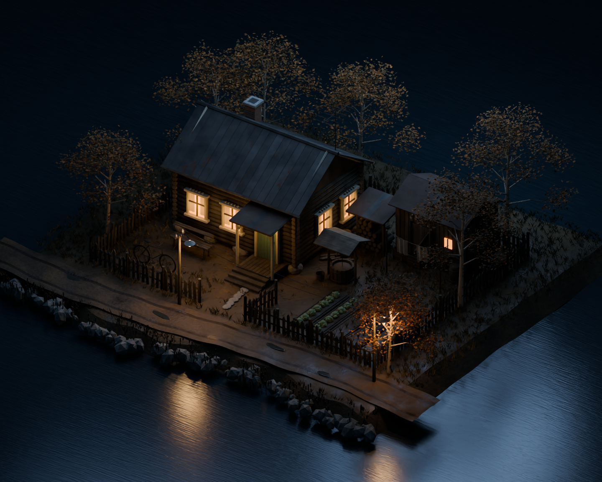

# Двор у реки — V2: сельский СССР, около 1980 года

Второй проход по редактируемой сцене Blender. Общий вид использует прежнюю камеру V1, а крупный план приближен к фасаду.

## Что изменено

- Направленные волокна, трещины, выцветание и различия между досками; потемнение нижних венцов от влаги.
- Выцветшая светлая краска наличников и старая зелёная краска двери; выветренные торцы брёвен.
- Матовая оцинкованная кровля с локальной коррозией и неодинаково состаренными листами.
- Разнородный грунт, влажные пятна и углублённые колеи вместо выпуклых линий.
- Складки штор и менее однородное свечение окон.
- Старая телевизионная антенна, стальной велосипед, оцинкованное ведро, номер дома на эмали, изоляторы и электрические лампы с отражателями.
- Слегка сложенные листья с пропусканием света.

Сельский образ условный, без привязки к конкретному региону СССР. Материалы процедурные. Подготовка под игровой движок пока не выполнена.

## До — V1

## После — V2

## Фасад и состаренные материалы крупнее

## Файл Blender

[Скачать сцену Blender и исходные скрипты ZIP-архивом](https://raw.githubusercontent.com/Eise-n-berg/gpt/main/courtyard-1980-v2/courtyard_1980_blender.zip)

Blender 4.3 или новее. Внешние текстуры и аддоны не нужны. В архиве отдельная сцена V2 и скрипты; V1 сохранена.
