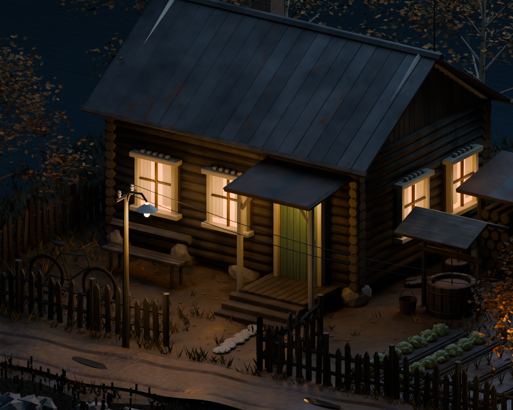
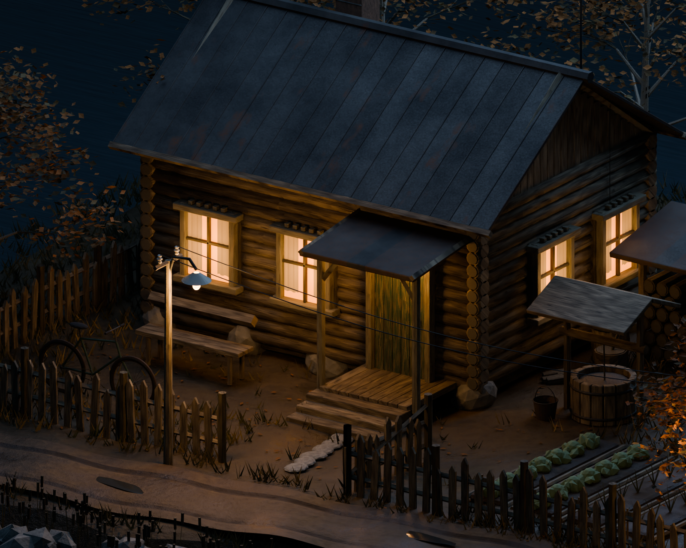
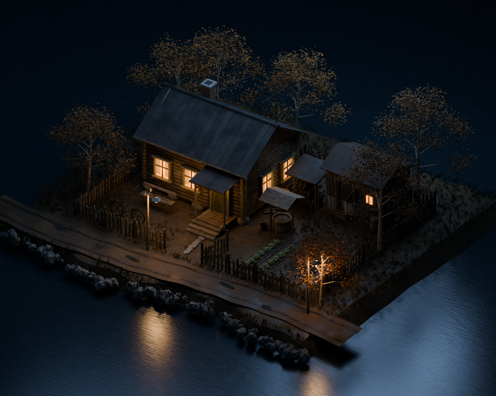

# Двор у реки — V3: фактура материалов

V3 продолжает сцену V2 для условного сельского СССР около 1980 года. Это настоящие рендеры редактируемой сцены Blender.

## Изменения

- Четыре оригинальные карты древесины **4096 × 1024**: цвет, высота, шероховатость и маска старой краски.
- Продольное волокно с обходом сучков, мелкие трещины и индивидуальное смещение фактуры на досках и брёвнах.
- Оголённая древесина под выцветшей краской двери и наличников.
- Мелкая структура оцинковки, потёки и неоднородная шероховатость кровли.
- Дополнительная мелкая фактура грунта.
- Отдельная камера для оценки материалов вблизи.

Карты созданы алгоритмически специально для сцены, это не фотоскан. Геометрия и растительность в основном сохранены из V2, поэтому стилизация остаётся. Исторический образ условный; подготовка под игровой движок пока не выполнена.

## Сравнение одного ракурса

### До — V2

### После — V3

## Общий вид

## Сцена Blender
[Скачать ZIP: сцена V3 и исходные скрипты](https://raw.githubusercontent.com/Eise-n-berg/gpt/main/courtyard-1980-v3/courtyard_1980_v3_blender.zip)

Blender 4.3+. Четыре карты упакованы внутрь .blend. Аддоны и отдельные текстурные файлы для открытия сцены не нужны. Архив около 11,6 МБ.

Проверено повторное открытие .blend, наличие четырёх упакованных карт 4096×1024 и камер. Финальные PNG: Cycles CPU, внешний OIDN с небольшой примесью исходного рендера для сохранения фактуры. Скрипты и пояснения включены в архив. V1 и V2 сохранены в соседних папках.
