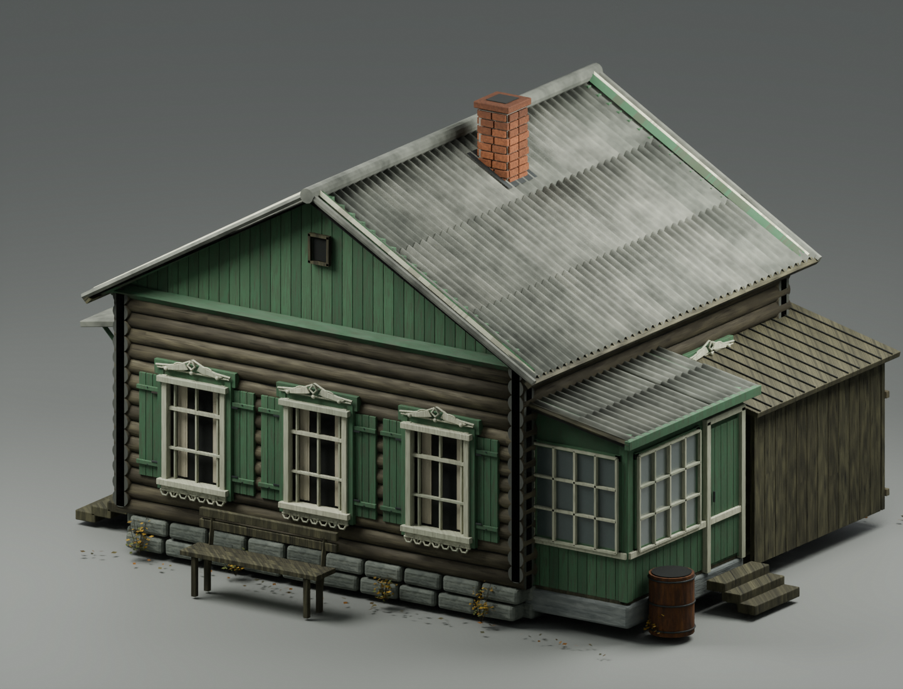
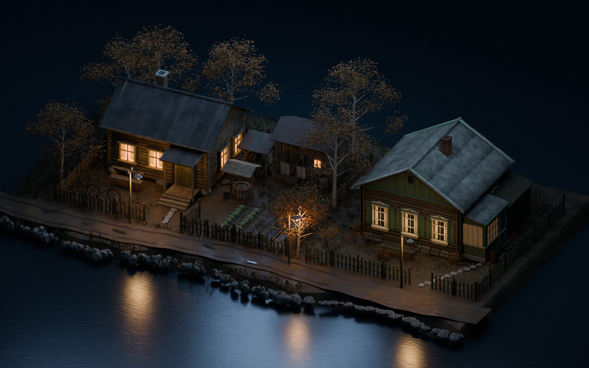

# Проба пикселизации V5 — сила 1%

Точная обработка готовых рендеров V5 в композиторе Blender. Геометрия, материалы, камера и разрешение кадров сохранены.

**1% здесь — сила смешивания:** 99% исходного кадра + 1% пикселизированного, в линейном пространстве композитора. Размер квадратного блока — 14 пикселей. При такой силе изменение намеренно очень слабое; сравнивать лучше в полном размере.

## Дневной кадр

| Исходный V5 | Сила эффекта 1% |
| --- | --- |
|  |  |

[Оригинал в полном размере](../courtyard-reference-house-v5/02_asset_daylight.png) · [Обработанный кадр в полном размере](01_daylight_1pct.png)

## Вечерняя локация

| Исходный V5 | Сила эффекта 1% |
| --- | --- |
|  |  |

## Настройка Blender

[Скачать проект композитора и скрипт подключения — ZIP, около 1,4 МБ](https://raw.githubusercontent.com/Eise-n-berg/gpt/main/courtyard-pixelation-1pct/pixelation_compositor_1pct.zip)

Blender 4.3+. В `pixelation_preview.blend` упакован исходный дневной кадр; F12 воспроизводит обработку. Это проект постобработки, отдельный от модели дома.

В группе `Pixelation • adjustable 1 percent`:
- `Strength`: 0.01 = 1%, 0.05 = 5%, 0.10 = 10%.
- `Block pixels`: размер блоков, сейчас 14 пикселей.

Необязательный `apply_pixelation_to_scene.py` подключает эту группу после финального изображения в композиторе открытой сцены и сохраняет отдельный .blend с суффиксом `_pixel_1pct`.

Фильтр: Scale → Pixelate → Scale → смешивание с исходником. Финальные PNG этой страницы получены этим фильтром. Генеративная проба, показанная ранее в чате, не используется в этих файлах.

Проверены параметры группы, наличие упакованного исходника и совпадение размеров кадров: дневной 1440×1100, вечерний 1600×1000.

[Дом V5 без эффекта](../courtyard-reference-house-v5/)
