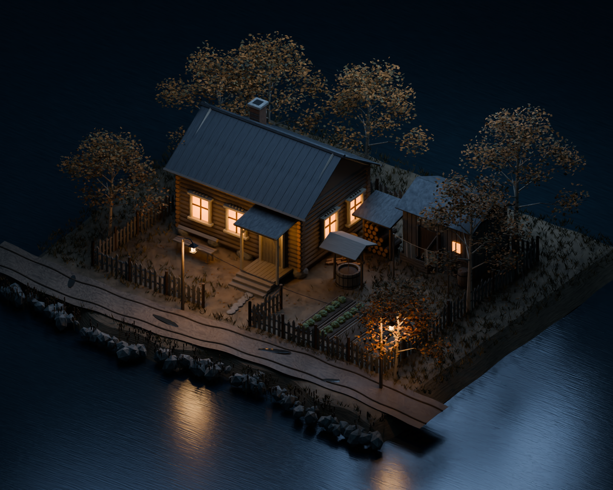
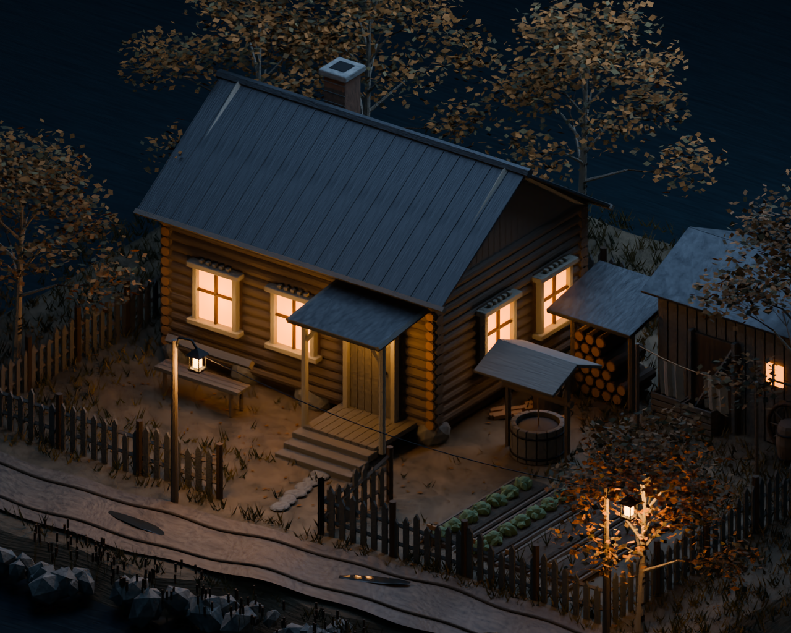
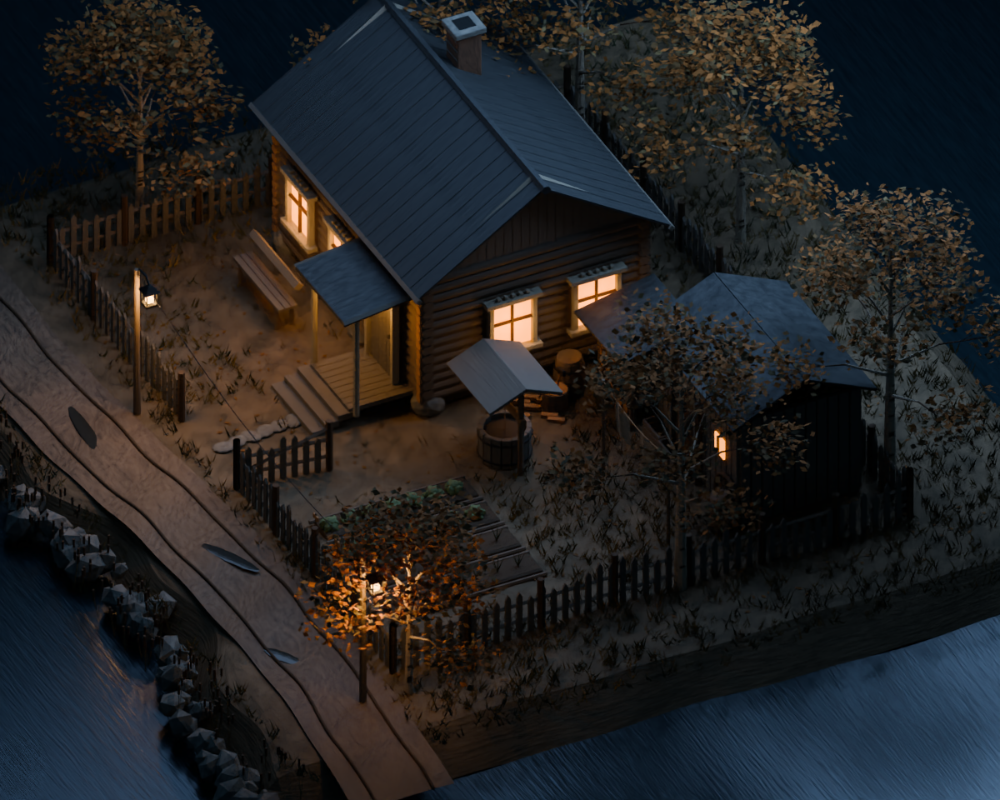
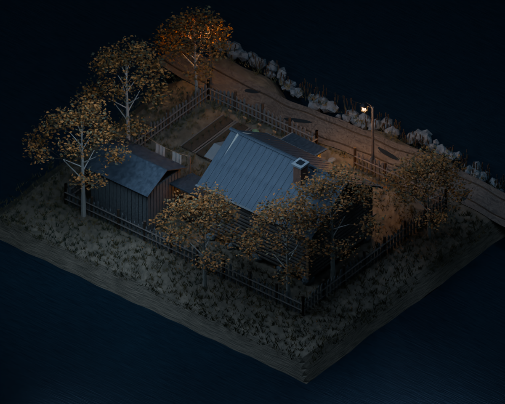

# Двор у реки — четыре ракурса

Рендеры одной сцены Blender, собранной по референсу. Это первый визуальный прототип.

## 1. Общий вид двора

## 2. Дом и крыльцо крупнее

## 3. Вид со стороны огорода

## 4. Обратная сторона участка

[Скачать все изображения ZIP-архивом](https://github.com/Eise-n-berg/gpt/archive/refs/heads/main.zip)

PNG — исходные готовые рендеры без изменения размера. В архиве находятся эта папка и README.
