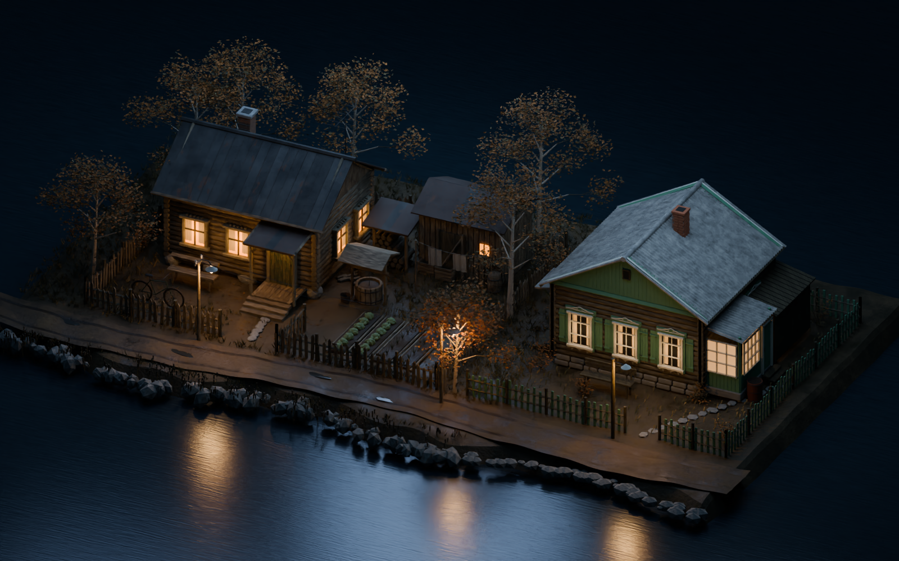
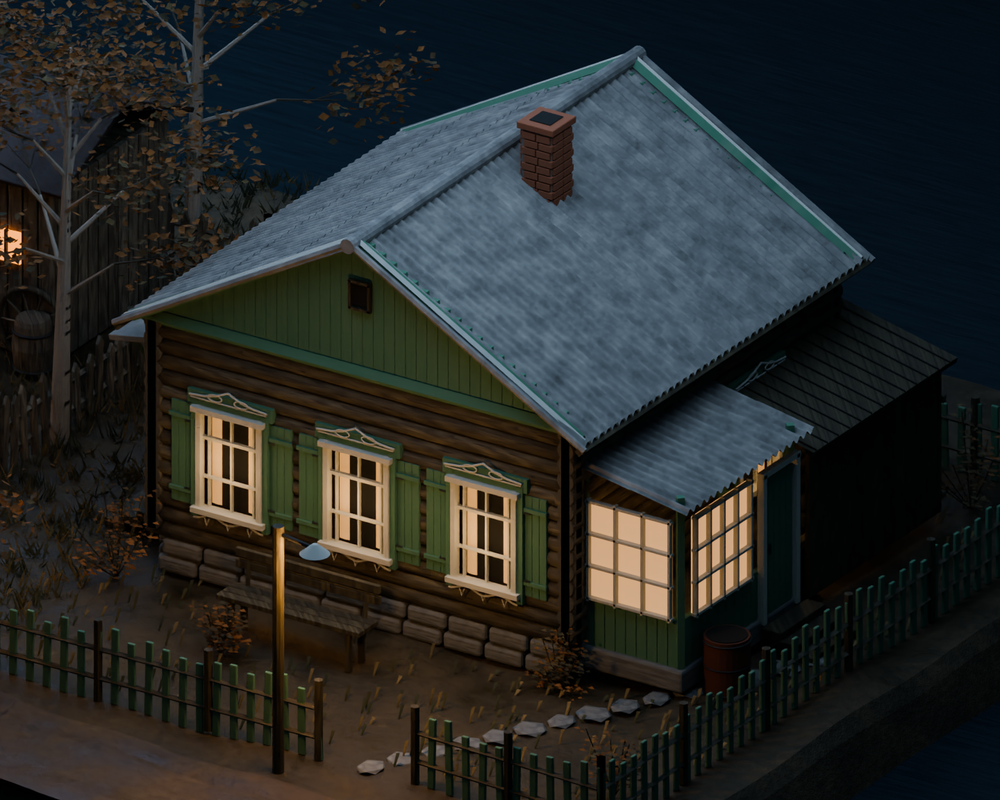
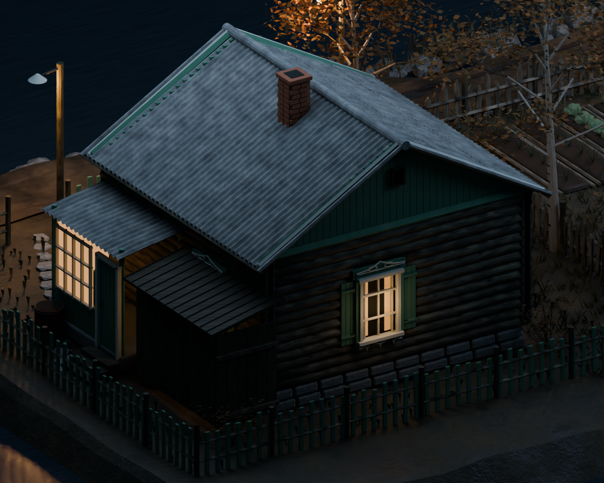

# Дом с зелёными ставнями — V4

Новый редактируемый дом Blender по предоставленному пользователем референсу с пятью видами. Он размещён рядом с прежним домом V3, на продолжении того же берега и дороги.

## Оба дома в одной локации

**Прежний дом слева, новый справа.** Общая вечерняя атмосфера сохранена.

## Новый дом — фасад и веранда

## Задний фасад и хозяйственная пристройка

## Отдельный ассет при нейтральном дневном свете

Этот кадр помогает оценить пропорции и цвета материалов без вечернего освещения.

## Скачать Blender

- [Отдельный дом — ZIP, около 7,4 МБ](https://raw.githubusercontent.com/Eise-n-berg/gpt/main/courtyard-reference-house-v4/green_shutter_house_asset.zip)
- [Локация с двумя домами — ZIP, около 12,5 МБ](https://raw.githubusercontent.com/Eise-n-berg/gpt/main/courtyard-reference-house-v4/two_houses_comparison_v4.zip)

В каждом архиве соответствующий .blend, пояснения на русском и исходные скрипты. **Blender 4.3+. Все четыре карты древесины упакованы внутрь .blend. Аддоны не нужны.**

## Что воспроизведено

- Сруб с тремя окнами на торцевом фасаде и реальными проёмами между брёвнами.
- Зелёные ставни и вертикальные доски фронтона.
- Объёмные белые наличники с декоративными контурами.
- Волнистый шифер с геометрией волн и нахлёстом листов, кирпичная труба.
- Каменный цоколь, остеклённая веранда, боковой вход, дощатая хозяйственная пристройка.
- Скамья, бочка, отдельный соседний двор и продолжение дороги.

Основной сруб около 6×5,8 м, конёк 5,3 м, с трубой около 5,85 м. Это интерпретация референса без точного обмера. Базовая сетка нового ассета — около 21 тыс. полигонов; модификаторы добавляют геометрию.

Коллекция нового дома: `V4 • REFERENCE HOUSE / complete asset`. В отдельном файле центр дома находится в (0,0,0) на уровне земли. Камеры, свет и фон для просмотра вынесены в `REVIEW ONLY`.

Это ассет для визуальной оценки в Blender. LOD, коллизии и перенос материалов в игровой движок пока не подготовлены.

## Проверка

Повторно открыты оба файла. Проверены упакованные текстуры и начало координат отдельного ассета. Геометрия, размещение и назначения материалов 500 объектов исходного дома и его построек совпадают с V3. Финальные изображения посчитаны в Cycles, шумоподавление выполнено внешним OpenImageDenoise.

[V3 до добавления нового дома](../courtyard-1980-v3/)
