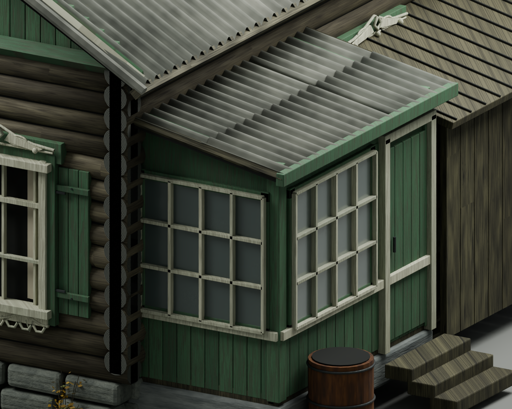
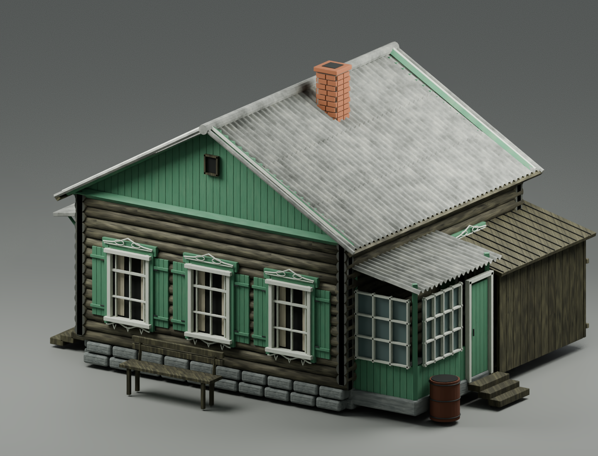
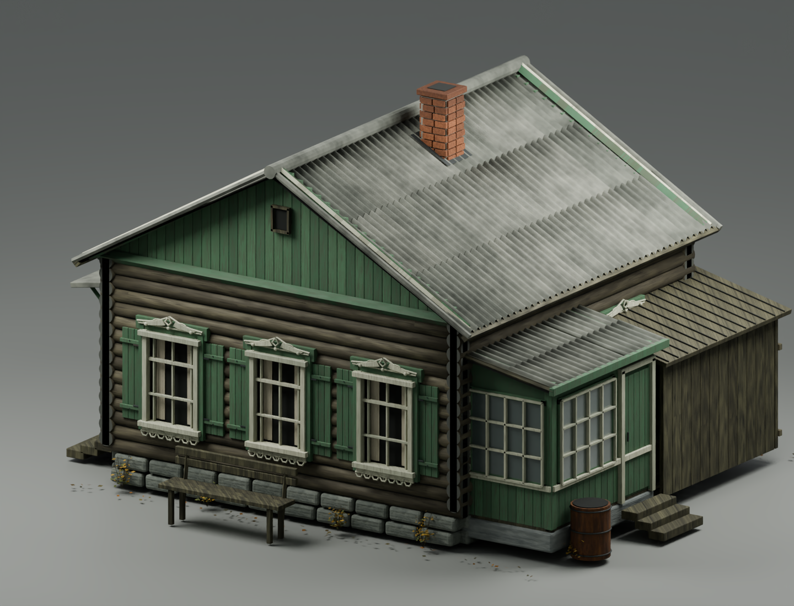
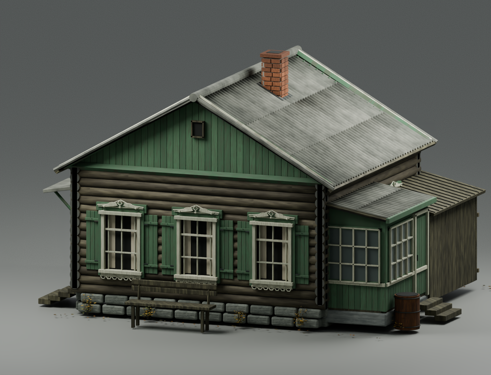
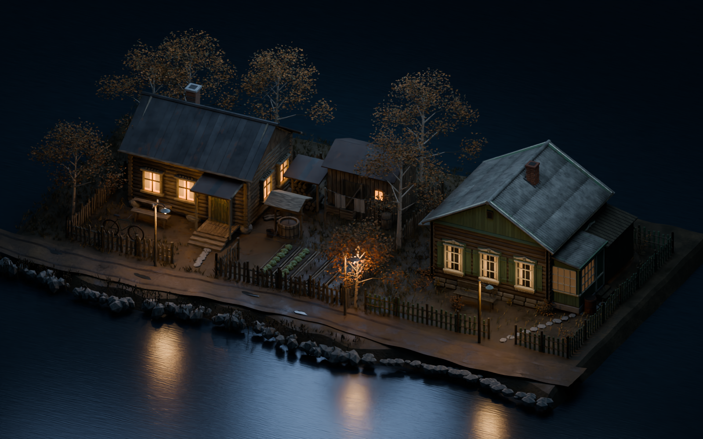

# Дом с зелёными ставнями — V5: стыки веранды и визуал

Веранда пересобрана после замечания о сквозной щели. Геометрия и материалы нового дома доработаны по тому же референсу с пятью видами. Прежние версии сохранены.

## Исправленный угол веранды

Над и сбоку от остекления теперь есть сплошная обшивка, стойки, доборы и оконные коробки. Отдельные стёкла заходят в фальцы рам. Под скатом сделан потолок; под нижними досками — сплошная подкладка. Перекрыт стык над дверным полотном.

## Один ракурс до и после

### V4

### V5

- Более тёмный серый шифер, неодинаковые листы, потёки и редкий лишайник.
- Менее однотонная краска и локальные потери покрытия.
- Смягчена широкая фактура древесины и избыточный рельеф белых рам.
- Добавлены объёмные элементы резьбы, продольные трещины дерева и крепления ставен.
- Неоднородные кирпичи, сажа у устья трубы и кровельное примыкание.
- Различия между камнями цоколя, фактура ржавой бочки и разреженная осенняя растительность.

## Передний фасад с меньшей высоты

## В общей локации

Прежний дом слева, новый справа. Камера сравнения сохранена.

## Скачать Blender

- [Отдельный дом V5 — ZIP, около 7,6 МБ](https://raw.githubusercontent.com/Eise-n-berg/gpt/main/courtyard-reference-house-v5/green_shutter_house_v5.zip)
- [Локация с двумя домами V5 — ZIP, около 12,5 МБ](https://raw.githubusercontent.com/Eise-n-berg/gpt/main/courtyard-reference-house-v5/two_houses_comparison_v5.zip)

**Blender 4.3+. Четыре карты древесины упакованы внутрь .blend. Аддоны не нужны.**

Архив отдельного дома содержит .blend, полные пояснения, исходные скрипты и журнал проверки стыков. Архив локации содержит .blend и краткую инструкцию. Для открытия готовых сцен запускать скрипты не нужно.

Коллекция дома — `V5 • REFERENCE HOUSE / complete asset`. Студийные камеры, свет и фон находятся в `REVIEW ONLY`. Низкую осеннюю растительность можно отключить отдельной коллекцией `09 optional autumn planting`.

## Проверка

Оба .blend повторно открыты; проверены начало координат отдельного дома и четыре упакованные карты. **49 направленных проверок лучами** прошли в зонах верхней обшивки, боковых доборов, дверной перемычки, нижней подкладки и потолка веранды. Геометрия, размещение и назначения материалов 500 объектов прежнего дома и построек совпадают с V4.

PNG — настоящие рендеры этих сцен в Cycles CPU с внешним OpenImageDenoise. Дневной общий вид и крупный план веранды посчитаны с 48 сэмплами вместо 32 в V4.

Сцена остаётся стилизованной интерпретацией референса; форма брёвен и растительность ещё упрощены. LOD, коллизии и перенос материалов в игровой движок не подготовлены.

[Предыдущая версия V4](../courtyard-reference-house-v4/)
